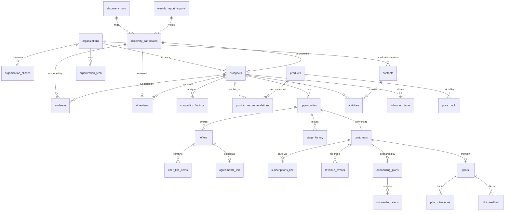

# 76 — Venuewise Hockey Intelligence Revenue Center: Architecture for Approval

> **SUPERSEDED by [doc 77](77-hlg-revenue-center-architecture.md) (2026-11-24).** Kept for history; it was hockey-specific.

**Owner:** Keith Herman, CEO & Product Owner · **Author:** Claude (engineering) ·
**Date:** 2026-11-24 · **Status:** Architecture for approval. **Nothing is built, applied or deployed.**

## 0. Read this first — three things that need your attention

1. **The "Venuewise Revenue Center Claude Build Specification" did not reach me.** There is no attachment in this
   session and no copy in the repository (searched for `*venuewise*`, `*revenue*center*`). This document is built from
   your written brief only. **I will not treat it as the authoritative requirements document until I have read the
   real one.** Section 12 lists what in this design is a guess pending the spec. Please re-attach it, or put it in
   Google Drive and tell me the name; I can read Drive.
2. **There is no CRM to reuse, but there is a lot of plumbing to reuse.** Detail in §1. The recommendation is to build
   a `revenue` schema inside the existing HL-BOS Core project, not a new Supabase project.
3. **Two items in your brief collide with standing rules, and I am following the rules:** nothing is applied to any
   database, deployed, or billed live without your approval (including Stripe test mode keys, which only you can
   create), and nothing contacts a prospect automatically. Both are built as hard gates, not conventions.

---

## 1. Existing infrastructure audit

Everything below was read-only. No database was written to, no migration applied.

### 1.1 Supabase projects (4, one organization)

| Project                         | Ref                    | Region    | What it is                                                                                       | Verdict for Revenue Center                                                                                                                                                                                       |
| ------------------------------- | ---------------------- | --------- | ------------------------------------------------------------------------------------------------ | ---------------------------------------------------------------------------------------------------------------------------------------------------------------------------------------------------------------- |
| **HL-BOS Core**                 | `mvvtngiopdrgiedjmhfb` | us-west-2 | Canonical platform (ADR-0001). 60 numbered migrations applied (0001–0060) plus product ones      | **Target.** Has identity, tenancy, roles/permissions, audit, AI gateway, events, workflows, entitlements, billing                                                                                                |
| **Venuewise Platform**          | `urwnbskrtoplgnkkxuvl` | us-east-1 | Live youth-sports operations app (families, schedules, SMS, 5-Star media). 93 tables, RLS on all | **Do not reuse, do not modify.** It has a `leads` table (21 rows) but that is inbound-form capture for the live app, not B2B sales. Putting a sales pipeline in a production consumer app mixes domains and risk |
| Herman Legacy Business Platform | `bkfsjhhclbqrhaolvhmz` | us-east-1 | Legacy; open security findings                                                                   | **Out of scope** (CLAUDE.md). Not touched                                                                                                                                                                        |
| HSCS Driver Recruitment         | `mgtvqsxxgqkdppfymznw` | us-east-1 | Trucking recruiting app, created 2026-11-19                                                      | Unrelated                                                                                                                                                                                                        |

### 1.2 What HL-BOS Core already provides (reuse, do not rebuild)

| Need in Revenue Center             | Existing asset                                                                                                               | Status                                                                                         |
| ---------------------------------- | ---------------------------------------------------------------------------------------------------------------------------- | ---------------------------------------------------------------------------------------------- |
| Auth, tenants, membership, RBAC    | `identity.*`, `platform.tenants`, permission model (`identity.has_permission`)                                               | Live. Revenue permissions are added as rows                                                    |
| Audit trail                        | `audit.events`, `audit.security_events`                                                                                      | Live                                                                                           |
| AI calls, cost caps, guardrails    | `ai.providers/models/prompts/prompt_versions/runs/budgets/guardrails`                                                        | Live schema; no provider key set                                                               |
| Domain events / outbox             | `events.outbox/subscriptions/deliveries/handlers`                                                                            | Live                                                                                           |
| Approval gates, tasks              | `workflows.instances/tasks/approvals`                                                                                        | Live                                                                                           |
| Plans, entitlements, modules       | `entitlements.*`, `billing.plans/subscriptions/invoices/payments` (Stripe provider seeded **inactive**)                      | Schema live; Stripe not wired                                                                  |
| Proposals, prices, agreements      | `sales.prices/proposals/proposal_line_items/agreements/agreement_acceptances`                                                | **In repo + pgTAP tested, never applied to a live project** (docs/75)                          |
| Consent, suppression, templates    | `comms.consent/suppression/templates/messages`                                                                               | Same: in migrations, not applied                                                               |
| Prospect discovery building blocks | `packages/presence-scanner`: `dedupe`, `import` (CSV/paste), `places`, `robots`, `qualify`, `score`, `export`, WNY gazetteer | Built, tested; local-only                                                                      |
| Prospect kanban pattern            | console Lead Board (`apps/control-center`, `/presence`)                                                                      | Local-only; pattern to copy                                                                    |
| Cloud-hostable Next.js app pattern | `apps/executive-portal` (Supabase Auth, Coolify config), `apps/hl-bti` Dockerfile                                            | Built; `docs/architecture-audit/hlvs-phase-7-executive-portal/01-coolify-deployment-config.md` |
| CI, secret scanning, TS pin        | `.github/workflows`, `scripts/check-*.sh`                                                                                    | Live                                                                                           |

### 1.3 Other repositories (15 under KeithVenuewise73)

`homehuddle`, `5star-sports-media`, `hscs-driver-recruitment`, `characterstudio`, `HSCS-GLP`, `hl-jobscout`,
`herman-supply-chain`, and static-site repos. **None is a sales CRM.** `hl-jobscout` has an alert/scheduling pattern
worth a look in Phase 1 only if I need a scheduled-job precedent. I only inspected names and activity, not contents.

### 1.4 Connectors in this environment

A **HubSpot** connector is attached. HubSpot is a possible future _sync target_, not the system of record: your
requirement is an independent, evidence-backed discovery pipeline with audit trails inside our own RLS boundary, and
`CLAUDE.md` forbids leaving a control that "controls nothing". I have not queried your HubSpot account. If it already
holds hockey contacts, tell me and I will add an import step (§7).

### 1.5 Audit conclusion

- **Reuse:** identity/RBAC, audit, AI gateway, events, workflows, billing/entitlements, `sales.*`, `comms.*`
  consent/suppression, presence-scanner discovery utilities, executive-portal app pattern, CI.
- **Build new:** a `revenue` schema (prospects, evidence, decision-makers, pool/queue, pipeline, pilot, onboarding,
  recurring revenue, follow-ups), a `packages/revenue-engine` library, and `apps/revenue-center`.
- **Not duplicated:** no second auth, audit, AI-metering or billing system.

---

## 2. Recommended repository architecture

Same monorepo (`hl-bos-platform`) — it already has CI, the TypeScript pin, the migration checks and secret scanning.
A separate repo would cost all of that and make the later HLG Revenue Center merge harder.

```
apps/revenue-center/                Next.js (App Router) + React + TS. Port 4400. Dockerfile. Supabase Auth.
  src/app/(auth)/                   sign-in, accept-invite
  src/app/(app)/                    all signed-in pages (§5)
  src/app/api/v1/                   REST route handlers (§6)
packages/revenue-engine/            pure TypeScript, no Next/Supabase imports; fully unit-tested
  src/scoring/                      fit score, evidence-confidence model
  src/research/                     source fetchers, claim extraction, verified-vs-assumed classifier
  src/review/                       AI review prompts, output schemas (zod), promotion rules
  src/import/                       weekly ChatGPT report parser (CSV/XLSX/MD/JSON), dedupe
  src/offers/                       product recommendation + proposal/offer generation
  src/pipeline/                     stage machine, forbidden transitions
  src/revenue/                      MRR/ARR math, WNYAHL pilot economics
packages/revenue-contracts/         zod schemas + OpenAPI generated from them (shared by app and tests)
supabase/migrations/                0061+ (revenue schema); supabase/tests/ pgTAP
docs/revenue-center/                runbook: backup, restore, export, ops
```

`apps/revenue-center` ships as its own Docker image, deployed on the existing Coolify host at
`revenue.venuewise.net`. **Independence from Hockey Intelligence:** the Revenue Center imports nothing from
the Hockey Intelligence scoring/analytics code, and Hockey Intelligence imports nothing from it. They meet only
through data we choose to expose later (e.g. a licence/entitlement row), never code.

**Path to the HLG Revenue Center:** every table carries `tenant_id` and a `division` text column
(`'venuewise-hockey'`). The Revenue Center is a _tenant_ inside HL-BOS Core. The HLG Revenue Center later reads the
same schema across tenants it is permitted to see, or consumes the `events.outbox` stream. No code change to Venuewise.

---

## 3. Recommended Supabase architecture

**Recommendation: a new `revenue` schema in HL-BOS Core. No new Supabase project.**

| Option                                           | Cost                                 | Isolation                       | HLG integration          | Verdict                                                    |
| ------------------------------------------------ | ------------------------------------ | ------------------------------- | ------------------------ | ---------------------------------------------------------- |
| A. `revenue` schema in HL-BOS Core (tenant RLS)  | $0 added                             | Row-level, tested by pgTAP      | Native                   | **Recommended**                                            |
| B. Dedicated "Venuewise Revenue" project         | New paid project, quoted at approval | Physical                        | Needs cross-project sync | Only if you want hard physical separation of customer data |
| C. Put it in "Venuewise Platform" production app | $0                                   | Weak: shares a live consumer DB | Poor                     | **Rejected**                                               |

Design rules:

- Every table: `id uuid`, `tenant_id`, `division`, `created_at/by`, `updated_at/by`, soft-delete `archived_at`.
- RLS on every table, policies call `identity.has_permission(tenant_id, 'revenue.<resource>.<action>')`. Never role names.
- Writes that change state (promote, stage move, approve, send) go through `security definer` functions with
  `set search_path = ''`, which also write `audit.events` in the same transaction. Direct table writes by the app role
  are limited to draft fields.
- Extensions already present (`citext`, `pg_trgm` for fuzzy dedupe); add `pg_cron` only on approval for scheduled jobs.
- Storage: one private bucket `revenue-evidence` (saved copies of source pages, uploaded weekly reports, generated
  proposals). Signed URLs only.
- Migrations numbered `0061`+ in `supabase/migrations`, pgTAP in `supabase/tests`. **Applied nowhere until you approve**;
  first application would be to a Supabase branch or local stack, then to Core on your explicit say-so.

---

## 4. Database ERD (proposed `revenue` schema, 31 tables)



| Group            | Tables                                                                                                                                                                                                           |
| ---------------- | ---------------------------------------------------------------------------------------------------------------------------------------------------------------------------------------------------------------- |
| Discovery        | `discovery_runs`, `discovery_candidates`, `weekly_report_imports`, `source_registry` (allowed sources + robots/terms status), `discovery_quota` (weekly target, region priority)                                 |
| Research         | `evidence` (claim, source URL, retrieved_at, saved-copy path, `status` = verified / unverified / assumption / contradicted, confidence), `ai_reviews`, `competitor_findings`, `organization_tech`                |
| CRM              | `organizations`, `organization_aliases`, `contacts` (with `source_evidence_id`, `contact_basis`), `prospects`, `activities`                                                                                      |
| Product/offer    | `products`, `price_book`, `product_recommendations`, `offers`, `offer_line_items`, `offer_templates`                                                                                                             |
| Pipeline         | `opportunities`, `stage_history`, `follow_up_tasks`, `follow_up_rules`                                                                                                                                           |
| Customer/revenue | `customers`, `revenue_events` (MRR delta ledger: new / expansion / contraction / churn), `subscriptions_link` and `agreements_link` (FKs to existing `billing.subscriptions` and `sales.agreements`, not copies) |
| Pilot/onboarding | `pilots`, `pilot_milestones`, `pilot_feedback`, `onboarding_plans`, `onboarding_steps`                                                                                                                           |
| Ops              | `export_jobs`, `backup_log`                                                                                                                                                                                      |

Key constraints (each gets a pgTAP test):

- `evidence.status = 'verified'` requires `source_url` **and** `retrieved_at` **and** a saved copy; otherwise the row cannot be inserted as verified.
- A prospect cannot reach "verified" with fewer than N verified evidence rows covering identity, level/region and a reachable contact path (N set after I read the spec).
- `contacts` store only business-published contact information with the source recorded; no purchased lists, no scraped personal social accounts, nothing about minors.
- `revenue_events` is append-only (update/delete denied by trigger). MRR is always derived from it, never typed in.
- No `revenue` row can be created with `is_sample = true` outside a test schema, so seed/demo data cannot appear in production views.

---

## 5. Navigation and page inventory

| Section       | Pages                                                                                                                                                                                                                                                                                        |
| ------------- | -------------------------------------------------------------------------------------------------------------------------------------------------------------------------------------------------------------------------------------------------------------------------------------------- |
| **Home**      | Dashboard: real counts only (pool, queue, prospects vs the 200 target, this week's discovered/qualified vs 20, pipeline value, MRR). Any panel without data says so and why                                                                                                                  |
| **Discovery** | Discovery Pool (filter by region/level/league, bulk select) · AI Review Queue (approve / reject / needs-research, one-click Promote) · Weekly Import (upload ChatGPT report, preview, map, commit) · Discovery Runs (history, cost, errors) · Sources (allowed-source list) · Weekly Targets |
| **Prospects** | Prospect list (saved filters, search, export) · Prospect detail (tabs: Overview, Evidence, Competitors & Tech, Contacts, Recommendations, Offers, Activity, Tasks) · Duplicates & merge                                                                                                      |
| **Contacts**  | Decision-makers directory · Contact detail                                                                                                                                                                                                                                                   |
| **Offers**    | Product catalogue · Price book · Recommendations · Offer builder · Proposal preview/PDF · Templates                                                                                                                                                                                          |
| **Pipeline**  | Board (drag to move, gated) · Table view · Stage rules · Forecast (probability × value, labelled as estimate)                                                                                                                                                                                |
| **Pilot**     | WNYAHL Pilot: scope, milestones, feedback, success criteria, conversion decision                                                                                                                                                                                                             |
| **Customers** | Customer list · Customer detail · Onboarding plans and checklists                                                                                                                                                                                                                            |
| **Revenue**   | MRR/ARR, movement ledger, Stripe test-mode status, invoices (test-mode badge visible on every screen while in test mode)                                                                                                                                                                     |
| **Tasks**     | My follow-ups, overdue, by prospect · Follow-up rules                                                                                                                                                                                                                                        |
| **Reports**   | Funnel, region coverage, source quality, AI cost per qualified prospect · Exports (CSV/XLSX/JSON, audit-logged)                                                                                                                                                                              |
| **Admin**     | Users & roles · Audit log viewer · AI budgets & prompts (view) · Integrations · Backup status · Settings                                                                                                                                                                                     |

---

## 6. API architecture

- REST, JSON, versioned `/api/v1`, Next.js route handlers backed by `packages/revenue-engine`; OpenAPI generated from the zod contracts in `revenue-contracts`.
- Auth: Supabase Auth JWT (cookie for browser, bearer for API). Each handler: authenticate → resolve tenant → check permission → validate input (zod) → call a DB function → return a typed error envelope `{error:{code,message,field?}}`. No stack traces to clients.
- Service-role key used **only** in the worker (§7), never in browser code (CI already runs `check-no-public-secrets.sh`).
- Idempotency keys on all POST that create or promote; optimistic concurrency via `updated_at` on edits.
- Pagination: keyset. Rate limits per user on write and export endpoints.

| Resource                               | Operations                                                                     |
| -------------------------------------- | ------------------------------------------------------------------------------ |
| `/discovery/candidates`                | list, get, reject, **promote** (→ prospect, one transaction, audited)          |
| `/discovery/runs`                      | list, get, start (permission-gated, quota-checked)                             |
| `/discovery/imports`                   | upload, preview, commit, list                                                  |
| `/reviews`                             | queue list, decide (approve / reject / request-research)                       |
| `/prospects`, `/contacts`, `/evidence` | CRUD (archive, not delete), merge                                              |
| `/prospects/{id}/recommendations`      | generate, list, accept                                                         |
| `/offers`                              | create from opportunity, edit, render, **approve**, mark sent (manual)         |
| `/opportunities`                       | CRUD, **move stage** (rules enforced server-side)                              |
| `/tasks`                               | CRUD, complete, snooze                                                         |
| `/pilots`, `/customers`, `/onboarding` | CRUD + milestone/step transitions                                              |
| `/revenue`                             | read MRR/ARR/ledger; `/revenue/stripe/webhook` (signature-verified, test mode) |
| `/exports`                             | create job, download (signed URL)                                              |
| `/admin/audit`, `/admin/users`         | read; role assignment                                                          |

Webhooks: Stripe only, signature verified, replay-protected via stored event IDs.

---

## 7. Automated research and AI review architecture

```
 Weekly trigger (cron, on approval)           CEO uploads ChatGPT weekly report
        │                                              │
        ▼                                              ▼
  Discovery worker ──► source adapters         Import parser (CSV/XLSX/MD/JSON)
  (allowed sources only,  (league directories,   │ every claim kept as UNVERIFIED
   robots.txt honoured,    association sites,    │ with "reported by ChatGPT" provenance
   rate limited)           Google Places if key) │
        └──────────────┬───────────────────────────┘
                       ▼
              normalise + dedupe (pg_trgm, domain, name+region)
                       ▼
        DISCOVERY POOL  (discovery_candidates, status = new)
                       ▼
        Research worker: fetch each claim's source page, save a copy,
        extract the claim, compare → evidence row (verified / unverified /
        contradicted). Claims with no retrievable source stay "assumption".
                       ▼
        AI review (via ai gateway): structured JSON only (zod-validated)
          - fit score with per-factor evidence references
          - competitor / technology detection (from fetched page content)
          - decision-maker candidates (role + source, never guessed emails)
          - recommended products + rationale
          - list of what is assumed, what is verified, what is missing
                       ▼
        AI REVIEW QUEUE ──► human: Approve / Reject / Needs research
                       ▼  (one click)
        PROMOTE → organizations + prospects + contacts + evidence copied,
                  audit event, follow-up tasks created
```

Rules enforced in code and tests:

1. **Verified means retrievable.** The AI may not set `verified`; only the research worker can, after it fetched the source and the extracted text actually supports the claim (substring/semantic check against the saved copy). The AI proposes; the evidence rule decides.
2. **Model output is untrusted input.** Every response is schema-validated; a failure retries once then lands in the queue as "AI review failed", never as a score of zero.
3. **Fetched web content is untrusted too.** It is passed to the model as quoted data with an explicit instruction boundary (prompt-injection defence); the model has no tools that can write to the database.
4. **No auto-contact.** There is no outbound email/SMS/call code path in the Revenue Center. "Mark as sent" is a manual log entry. `comms.suppression` is checked when this changes in a later phase, with a CEO approval gate per message (same as step 6 in docs/75).
5. **Cost controls.** `ai.budgets` hard weekly cap; each run records tokens and cost in `ai.runs`; the run stops and says so at the cap.
6. **Reproducibility.** Prompt version, model, and source snapshots are stored with every review.
7. **Targets are reported honestly.** The dashboard shows "X of 200 verified" using the verified definition above. If a week yields 9 qualified instead of 20, it says 9.
8. **Region priority** is a weighted ordering in `discovery_quota`: Western New York → New York State → Northeast → rest of US → Canada.

Provider note: no AI provider key and no search API key exist today. Both are credentials only you can grant (see §10).

---

## 8. Security and permissions model

**Roles** (rows in `identity.roles`, bundles of permissions):

| Role                    | Can do                                                                                 |
| ----------------------- | -------------------------------------------------------------------------------------- |
| `revenue_owner`         | Everything, including approve offers, promote, export, manage users, change AI budgets |
| `revenue_manager`       | Promote, edit prospects, move pipeline, build offers, run discovery; not users/budgets |
| `revenue_analyst`       | Review queue decisions, edit evidence/notes, no promote, no offers                     |
| `revenue_viewer`        | Read-only (no exports)                                                                 |
| `pilot_partner` (later) | Read-only, own pilot only (e.g. a WNYAHL representative); never sees other prospects   |

Permission vocabulary follows the existing `<domain>.<resource>.<action>` closed list, e.g. `revenue.prospect.promote`,
`revenue.offer.approve`, `revenue.export.create`, `revenue.audit.read`.

**Controls**

- RLS on every table, `tenant_id` isolation, default deny; pgTAP tests assert a signed-out user, another tenant, and every lower role each get nothing or are refused.
- State changes only via audited `security definer` functions; audit rows are append-only.
- MFA required for `revenue_owner`/`manager` (Supabase Auth TOTP) before production.
- Secrets in Vault / Coolify env only; never in the repo or browser; `check-no-public-secrets.sh` and gitleaks stay in CI.
- Input validation (zod) at every boundary; output encoding; CSP and security headers; CSRF-safe cookie settings; SSRF guard on the fetcher (block private IP ranges, redirects capped).
- Personal data: business contacts only, source recorded, deletion/"do not contact" flag honoured, retention rule, export and erasure supported. Canada (CASL) and US (CAN-SPAM, state law) obligations are outreach-time duties; they are why nothing sends automatically. **Counsel should review before any outreach feature is built.**
- Stripe: test-mode keys only, webhook signatures verified, no card data ever touches our servers (Checkout/Payment Links), live mode behind a separate CEO-approved switch that does not exist in Phase 1.

---

## 9. Development phases

Each phase ends with a working, tested capability and a merge-ready PR. Dollar figures in §10.

| Phase  | Deliverable (what works at the end)                                                                                                                                            | Needs from you                                              |
| ------ | ------------------------------------------------------------------------------------------------------------------------------------------------------------------------------ | ----------------------------------------------------------- |
| **0**  | This document approved; **specification re-attached and reconciled**; decisions in §12 answered                                                                                | Approve; send spec                                          |
| **1**  | Foundation: `revenue` schema migration (core CRM tables, RLS, audit functions, roles) + pgTAP; app shell, sign-in, roles; CI. Verified on local Postgres and a Supabase branch | Approval to create a **branch** (hourly cost, quoted first) |
| **2**  | Prospects, organizations, contacts, evidence, activities: full CRUD, filters, search, merge, CSV export                                                                        | —                                                           |
| **3**  | Discovery pool + **weekly report import** (your existing ChatGPT reports) + dedupe + review queue + one-click promote                                                          | A real sample weekly report                                 |
| **4**  | Automated research + AI review (source fetch, saved copies, verified/assumed split, scoring, competitor/tech, recommendations)                                                 | AI provider key (you create)                                |
| **5**  | Offers & proposals: products, price book, recommendation→offer builder, PDF, approval gate, `sales.*` wiring                                                                   | Pricing decisions; counsel-approved terms                   |
| **6**  | Pipeline, follow-up automation, tasks                                                                                                                                          | —                                                           |
| **7**  | WNYAHL pilot management, customers, onboarding                                                                                                                                 | WNYAHL scope facts (I will not invent them)                 |
| **8**  | Recurring revenue ledger + Stripe **test-mode** checkout/webhooks                                                                                                              | Stripe test keys (you create)                               |
| **9**  | Hardening: exports, backup/restore drill, load and security tests, runbook, Docker image, `revenue.venuewise.net` staging                                                      | Approval to deploy; DNS                                     |
| **10** | HLG Revenue Center integration (event stream + cross-tenant read role)                                                                                                         | Approval                                                    |

Production deploy and live billing are **not** in any phase; each needs a separate decision from you.

---

## 10. Estimated infrastructure and AI operating costs

**These are planning estimates, not quotes.** Vendor prices change; I have not checked current price sheets in this
session, and the AI figures depend on prompts I haven't built or measured. I will replace them with measured numbers
from `ai.runs` after Phase 4 and show them on the dashboard.

| Item                                  | Option A (recommended)                                                               | Notes                                                                          |
| ------------------------------------- | ------------------------------------------------------------------------------------ | ------------------------------------------------------------------------------ |
| Supabase                              | **$0 added** (HL-BOS Core already paid)                                              | Option B (separate project) adds a monthly Pro-tier charge, quoted at approval |
| Supabase dev branch (Phase 1 testing) | Hourly while it exists; delete after use                                             | Local Postgres covers most work; branch needs your cost approval               |
| Hosting                               | **$0 added** on existing Coolify host (small container)                              | Check host headroom in Phase 9                                                 |
| Domain/DNS                            | $0 if `venuewise.net` is yours; subdomain only                                       |                                                                                |
| Stripe                                | $0 in test mode; live fees (~2.9% + 30¢ typical) only after you approve live billing | Verify rates at that time                                                      |
| Search / places API                   | ~$0–50/mo (free tiers likely cover 20/wk)                                            | Optional; imports and public directory crawling work without it                |
| **AI: initial 200-prospect build**    | roughly **$150–600 one-time**                                                        | ~1–3 review passes per prospect, page fetch + extraction + scoring             |
| **AI: steady state (20/week)**        | roughly **$60–250 / month**                                                          | Dominated by research passes; capped by `ai.budgets`                           |
| Error monitoring / email (later)      | $0–30/mo                                                                             | Only if you want them                                                          |
| **Typical total**                     | **~$60–300/month** after build                                                       | Weekly AI hard cap makes the upper bound a setting, not a surprise             |

---

## 11. Testing and acceptance criteria

**Automated (all run in CI; I paste real output before claiming a pass):**

- pgTAP: every table's RLS (anon, other tenant, each role), every constraint in §4, append-only ledger, evidence-verified rule, promote transaction atomicity, audit row on every state change.
- Unit (vitest): scoring, verified/assumed classifier, report-import parser (fixture from a real report), dedupe, stage machine (forbidden transitions), MRR math, proposal totals.
- API contract tests against OpenAPI; negative tests (bad input, no permission, wrong tenant, duplicate idempotency key).
- Real-browser end-to-end (Playwright): every button, filter, form, nav item and workflow in §5 exercised; accessibility checks; mobile width.
- Security: secret scan, dependency audit, SSRF/prompt-injection fixtures (hostile page content must not change a verdict or reach the DB), export authorization.
- Resilience: AI timeout/invalid JSON, fetch failure, partial import, double-click promote, concurrent edits.
- Backup/restore drill on a scratch database with row-count and checksum comparison.

**Acceptance (CEO-readable):**

1. Uploading a real weekly ChatGPT report puts every row in the pool with provenance, none marked verified.
2. A candidate with a retrievable, supporting source becomes verified; one without stays "assumption" and the screen says which.
3. One click promotes an approved candidate into a prospect with evidence, contacts and tasks; clicking twice creates one.
4. The dashboard shows only real numbers; an empty database shows empty states with reasons.
5. A lower role and another tenant provably cannot read or change what they shouldn't.
6. Nothing in the system can send a message to a prospect.
7. Every state change is in the audit log; every export is logged.
8. Stripe test checkout updates the MRR ledger via webhook; the page says TEST MODE.
9. A restored backup matches the original.

**The "200 verified prospects" target** is acceptance of the _pipeline_, measured by the verified definition, and
depends on real-world availability of public information. I will report the actual count and will not pad it.

---

## 12. Risks, dependencies, and guesses pending the specification

**Dependencies (only you can grant):** the specification; an AI provider key; optionally a search/places key; Stripe
test keys; DNS for `revenue.venuewise.net`; approval to apply migrations to a branch and later to Core; WNYAHL facts
and consent to be named as a pilot; pricing; counsel review of offer/agreement terms and outreach rules.

| Risk                                                                | Likelihood | Mitigation                                                                                         |
| ------------------------------------------------------------------- | ---------- | -------------------------------------------------------------------------------------------------- |
| Spec differs from this design                                       | **High**   | Phase 0 reconciliation before any code                                                             |
| 200 truly verified prospects unreachable from public sources        | Medium     | Show honest verified count; imports and manual research fill gaps; no padding                      |
| AI hallucinates facts                                               | High       | Verified-only-by-fetcher rule; schema validation; human review queue; adversarial tests            |
| Prompt injection from scraped pages                                 | Medium     | Quoted-data boundary, no write tools for model, fixtures in CI                                     |
| Scraping terms/robots violations, IP blocks                         | Medium     | `source_registry`, robots honoured, rate limits, prefer directories that permit use                |
| Privacy/anti-spam law (CASL, CAN-SPAM, state)                       | Medium     | No auto-contact; business contacts only; counsel review before outreach                            |
| `sales.*`/`comms.*` migrations never applied live; may have drifted | Medium     | Re-verify against Core in Phase 1 (read-only) before depending on them                             |
| Shared Core: migration mistake affects other products               | Low–Med    | Branch first, pgTAP, lineage checks, explicit approval; Option B available if you prefer isolation |
| AI cost overrun                                                     | Low        | Hard weekly budget in `ai.budgets`                                                                 |
| Hosting host capacity                                               | Low        | Check in Phase 9                                                                                   |
| Scope: this is a large build                                        | High       | Phase gates; each phase ships working software                                                     |

**Decisions I need from you (answer, don't action):**

1. Re-send the specification.
2. Confirm Option A (schema in HL-BOS Core) or choose B (separate project, extra monthly cost).
3. Is there an existing hockey contact list in HubSpot or elsewhere I should import?
4. Can I look at one recent weekly ChatGPT prospecting report (so the importer matches the real format)?
5. Who besides you will use it, and in which roles?
