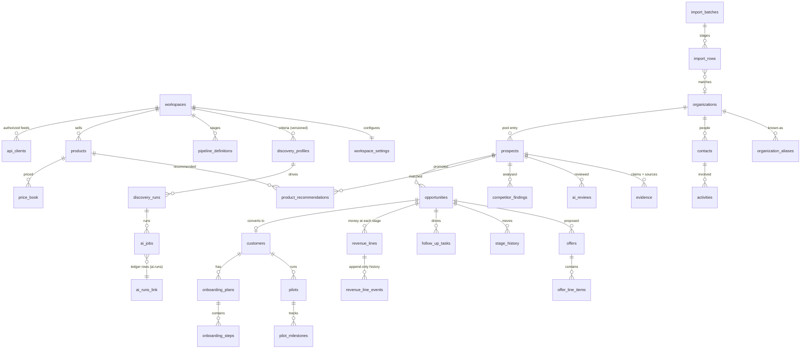

# 77 — HLG Revenue Center: Final Architecture for Approval

**Owner:** Keith Herman, CEO & Product Owner · **Author:** Claude (engineering) ·
**Date:** 2026-11-24 · **Status:** For approval. **Supersedes doc 76** (which was a hockey-specific first draft).
Nothing here has been applied to any database, deployed, or billed.

## 0. What changed, and what I could not do

**The two specification files are not available to me.** I searched Google Drive twice (by file name and by phrase) and
the whole container for `Venuewise-Revenue-Center-Claude-Spec.md` and `Venuewise-Claude-Build-Spec.md`. Nothing matched.
You said the Revenue Center spec _governs_ the CRM, so I will not claim conformance to it. This design follows your
decisions message. When the files reach me (attach them here, or save them to Drive and give me the exact title), I
will produce a one-page conformance table: each requirement, met / differs / missing. Anything that differs comes back to
you before it is built.

**What I built and proved this session (local only, no database touched):** `packages/revenue-contracts` — the versioned
prospect-import schema, the CSV template, a CSV-to-JSON converter, synthetic fixtures, and 14 passing tests (§6).
Testing found a real bug in my own first template (its example row put the value "Unknown" next to status `unknown`,
which the contract correctly rejects); it is fixed.

---

## 1. Final architecture in one page

```
                      HLG executive (Keith)  ── consolidated view of every workspace he is authorized for
                                   │
        ┌──────────────────────────┴───────────────────────────────────────────────┐
        │  HL-BOS Core (Supabase)         one `revenue` schema, shared by all workspaces │
        │  workspace = first-party tenant (platform.tenants, class first_party,           │
        │  parent = the HLG root tenant)  ->  RLS on tenant_id + identity.has_permission  │
        └───┬─────────────┬──────────────┬───────────────┬──────────────┬─────────────────┘
            │             │              │               │              │
    Venuewise Hockey   HLG Digital   HLG Digital     HSCS Consulting  HSCS Driver … 5-Star … future
    Intelligence       Services      Sports Agency   (each workspace has its OWN criteria, pools,
    (first workspace)                                 AI reviews, catalog, prices, proposals,
                                                      pipeline, revenue — configured, not coded)

  apps/revenue-center  (one Next.js app, workspace switcher)      packages/revenue-engine, revenue-contracts
  ── never shares tables or code with ──►  Venuewise Hockey Intelligence SaaS (its own app + its own database)
```

**Three decisions that make this permanent rather than hockey-specific**

1. **A workspace is a tenant.** HL-BOS already isolates tenants, has `first_party` tenants with a `parent_tenant_id`,
   permissions checked by `identity.has_permission(tenant_id, …)`, per-tenant AI budgets and run ledger, per-tenant
   entitlements and billing. Reusing that means isolation, budgets and permissions come from code that already has
   1,000+ passing database assertions, instead of a second isolation system I would have to invent and test.
2. **Everything vertical-specific is data, not code.** Hockey appears only as rows: a discovery profile, a product
   catalog, a stage set, a prompt version. A new business is `provision_workspace('hscs-driver-recruitment')` plus
   configuration. Zero schema changes, zero deploys.
3. **The Hockey Intelligence product stays outside.** The Revenue Center sells it; it does not contain it. The only
   bridge is a product-catalog row with an `external_product_key`, and, after a deal closes, a provisioning request
   through the existing `provisioning.requests` / `events.outbox` path or a signed API call. No shared tables, no
   shared code, no shared database.

---

## 2. Repository structure

Same monorepo (CI, TypeScript pin, secret scans, migration lineage checks already exist).

```
apps/revenue-center/              Next.js + React + TS. Workspace switcher. Docker image. Port 4400.
packages/revenue-contracts/       BUILT. Import schema v1, CSV template/converter, fixtures. zod 4. 14 tests.
packages/revenue-engine/          pure TS: scoring, evidence classifier, dedupe/match, pipeline rules,
                                  offer/proposal builder, revenue-stage math. No Next, no Supabase imports.
supabase/migrations/              0061+ `revenue` schema (written, tested locally, NOT applied)
supabase/tests/                   pgTAP: RLS, constraints, audit, workspace isolation
supabase/functions/revenue-*      research worker, import worker (Deno edge functions; reuse _shared/ai)
docs/revenue-center/              runbooks: local dev, backup/restore, workspace provisioning, import guide
```

---

## 3. Database ERD (`revenue` schema)

Every table below carries `tenant_id` (the workspace), `created_at/by`, `updated_at/by`, and where it makes sense
`archived_at` (no hard deletes of business records).



| Group                | Tables                                                                                                                                                                                                           |
| -------------------- | ---------------------------------------------------------------------------------------------------------------------------------------------------------------------------------------------------------------- |
| Workspace            | `workspaces` (1:1 with a tenant; slug, kind, default currency, status), `workspace_settings`, `api_clients` (hashed keys, workspace-scoped, per-permission)                                                      |
| Configuration        | `discovery_profiles` (versioned: target regions + priority order, org types, scoring weights, weekly quota, source allow-list), `pipeline_definitions` + `pipeline_stages`, `follow_up_rules`, `offer_templates` |
| Import               | `import_batches` (source: manual / bulk / csv / json / hubspot / api; schema version; status), `import_rows` (raw payload, issues, match candidates, decision)                                                   |
| Discovery & research | `discovery_runs`, `ai_jobs` (queue, attempts, backoff, dead-letter, links to `ai.runs`), `source_registry` (allowed sources, robots/terms notes), `evidence`, `ai_reviews`, `competitor_findings`                |
| CRM                  | `organizations`, `organization_aliases`, `contacts`, `prospects` (the pool/queue/promoted state), `activities`                                                                                                   |
| Catalog & offers     | `products` (incl. `external_product_key`), `price_book` (effective-dated), `product_recommendations`, `offers`, `offer_line_items`; wired to existing `sales.prices/proposals/agreements`                        |
| Pipeline             | `opportunities`, `stage_history` (append-only), `follow_up_tasks`                                                                                                                                                |
| Revenue              | `revenue_lines`, `revenue_line_events` (append-only)                                                                                                                                                             |
| Customer, pilot      | `customers`, `pilots`, `pilot_milestones`, `pilot_feedback`, `onboarding_plans`, `onboarding_steps`                                                                                                              |
| Operations           | `export_jobs`, `backup_log`                                                                                                                                                                                      |

**Revenue has four states and they are never blended** (decision 7). One `revenue_lines` row per money commitment:

| Stage          | Meaning                           | How a line enters it                                                           | Never                   |
| -------------- | --------------------------------- | ------------------------------------------------------------------------------ | ----------------------- |
| **projected**  | Estimate; no offer exists         | Created from a prospect's estimated annual contract value + stated assumptions | Counted as pipeline-won |
| **proposed**   | An approved offer has been issued | Offer approved and marked sent (a manual log entry)                            | Counted as contracted   |
| **contracted** | A signed agreement exists         | Linked `sales.agreement_acceptances` row                                       | Counted as collected    |
| **collected**  | Money received                    | Linked `billing.payments` row with status paid                                 | Entered by hand         |

Each line records amount, currency, recurring vs one-time, billing period, and `is_test`. **Stripe test-mode payments set
`is_test = true` and are excluded from every real total and shown on a separate, labelled "TEST" line.** A line only moves
forward by a database function that checks the evidence for the next stage; moves are logged in `revenue_line_events`.
Totals are per currency: USD and CAD are reported side by side and never silently converted.

Constraints that get a pgTAP test each: verified evidence needs a retrievable source and date; a collected line needs a
payment link; ledgers are append-only; a row's `tenant_id` must equal its parent's `tenant_id` (composite foreign keys,
so a child can never point at another workspace's parent); synthetic rows are rejected outside a test workspace.

---

## 4. Workspace isolation strategy

| Layer                | Control                                                                                                                                                                                                                                                                                                             |
| -------------------- | ------------------------------------------------------------------------------------------------------------------------------------------------------------------------------------------------------------------------------------------------------------------------------------------------------------------- |
| Identity             | A user is a member of specific workspaces (`identity.memberships`). Being in one grants nothing in another. Membership must be `active` and the tenant `trial`/`active` (existing rule: suspended means suspended for every role)                                                                                   |
| Rows                 | RLS on every table, forced: `using (identity.has_permission(tenant_id, 'revenue.<resource>.read'))`. Never role names                                                                                                                                                                                               |
| Children             | Composite FKs `(tenant_id, parent_id)` so cross-workspace links are impossible at the database level, not just hidden by RLS                                                                                                                                                                                        |
| Writes               | State changes only through `security definer`, `search_path = ''` functions that check the permission, write `audit.events` in the same transaction, and reject a mismatched `tenant_id`                                                                                                                            |
| AI                   | `ai.runs`/`ai.budgets` are already per tenant, so every workspace has its own spend limit and ledger. Prompts and discovery criteria are per workspace                                                                                                                                                              |
| Files                | One private storage bucket; object path begins with the workspace id; storage policies check membership on that prefix; signed URLs only                                                                                                                                                                            |
| API clients          | An API key is bound to exactly one workspace and a minimal permission set; stored hashed; revocable; every call audited                                                                                                                                                                                             |
| Product boundary     | Hockey Intelligence SaaS: separate app, separate database, no shared tables. Communication is a narrow signed API / event contract                                                                                                                                                                                  |
| **Executive view**   | **No bypass.** Keith holds a membership in each workspace. The consolidated dashboard runs the _same queries without a workspace filter_ and RLS returns only workspaces where he holds `revenue.report.read`. Add a workspace and it appears; remove his membership and it disappears. A new hire never sees "all" |
| Cross-workspace data | Not shared. The executive "overlap" report (same organization appearing in two workspaces) is computed only for a user authorized in both                                                                                                                                                                           |

Tests: for each table and each workspace pair, a user of workspace A gets zero rows and a refused write against workspace B;
a signed-out user gets nothing; a suspended membership gets nothing; an API key for A cannot read B; the executive sees
exactly the union of workspaces granted, no more.

---

## 5. Roles and permission matrix

Eight roles (decision 5) as rows in `identity.roles`, granted per workspace; permissions follow the existing
`<domain>.<resource>.<action>` vocabulary. `R` read · `W` create/edit · `A` approve/decide · `X` export · `—` none.
"Own" = only records assigned to the user.

| Capability                                   | HLG Super Admin | Division Admin | Sales Manager | Sales Rep   | Research Analyst | Proposal Manager | Finance & Reporting | Read-Only |
| -------------------------------------------- | --------------- | -------------- | ------------- | ----------- | ---------------- | ---------------- | ------------------- | --------- |
| Workspace settings, criteria, stages         | R W A           | R W A          | R             | —           | R                | —                | —                   | —         |
| Users and role assignment (within workspace) | R W A           | R W A          | —             | —           | —                | —                | —                   | —         |
| Discovery runs, import batches               | R W A           | R W A          | R W           | R           | R W              | —                | —                   | R         |
| AI review queue: decide / promote            | R W A           | R W A          | R W A         | R           | R W (decide)     | —                | —                   | R         |
| Organizations, prospects, contacts, evidence | R W A           | R W A          | R W           | R W (own)   | R W              | R                | R                   | R         |
| Product catalog, price book                  | R W A           | R W A          | R             | R           | R                | R W              | R                   | R         |
| Offers and proposals                         | R W A           | R W A          | R W A         | R W (draft) | —                | R W A            | R                   | R         |
| Pipeline and follow-up tasks                 | R W A           | R W A          | R W A         | R W (own)   | R                | R W              | R                   | R         |
| Customers, pilots, onboarding                | R W A           | R W A          | R W           | R W (own)   | —                | R W              | R                   | R         |
| Revenue lines and reports                    | R X             | R X            | R X           | R (own)     | —                | R                | R W X               | R         |
| Revenue stage moves                          | A               | A              | —             | —           | —                | —                | A (collected only)  | —         |
| AI spend limits, prompts, providers          | R W A           | R (workspace)  | —             | —           | —                | —                | R                   | —         |
| Audit log                                    | R               | R              | —             | —           | —                | —                | R                   | —         |
| Exports (CSV/JSON)                           | X               | X              | X             | —           | —                | —                | X                   | —         |
| Consolidated multi-workspace view            | R (all granted) | — (own only)   | —             | —           | —                | —                | R (granted)         | —         |

Rules: no role can approve its own work where two people exist (offer author ≠ approver once a second user is assigned);
the single-owner phase is allowed because you hold every role, and the approval is still recorded as a distinct,
timestamped act. Roles are rows, so a new role is data. **No additional paid accounts are required**: Supabase Auth has no
per-seat charge on the existing plan; future staff are simply invited.

---

## 6. Import schema and templates (built and tested)

`hlg.prospect-import` **v1.0.0**. Files in `packages/revenue-contracts`:

| File                                              | Purpose                                                                          |
| ------------------------------------------------- | -------------------------------------------------------------------------------- |
| `src/import-v1.ts`                                | The contract (zod). Source of truth                                              |
| `schemas/prospect-import.v1.schema.json`          | JSON Schema 2020-12, generated; a test asserts it matches the source             |
| `templates/prospect-import.v1.template.csv`       | The CSV ChatGPT fills in: 52 columns, header + one clearly synthetic example row |
| `src/csv.ts`                                      | RFC 4180 parser, CSV → report converter, row-and-column error messages           |
| `fixtures/synthetic/weekly-report.synthetic.json` | 3 invented prospects; all refs `SYNTH-…`, all domains reserved `example.*`       |

**All 20 report fields you listed are carried:** organization name, type, website, location, team count, scoresheet /
registration / analytics providers (each a claim with value + status + sources), public decision-maker(s) with source,
public business contact with source, operational needs, supporting source URLs, verified facts (each with its own source),
inferences and assumptions, recommended modules, integrate/replace/coexist recommendation, priority, estimated annual
contract value with currency and pricing assumptions, recommended next action, research date.

Rules enforced (each has a test): a `verified` claim or fact without a source URL is rejected; "unknown" must carry no value;
decision-makers need a public source; URLs must be http(s); dates are ISO; duplicate `external_ref` in one report is rejected;
unknown major version is rejected; **synthetic and real data cannot cross** (synthetic needs `SYNTH-` refs and reserved
domains, real reports may use neither). **"Verified" in a report is a claim by the report.** The importer stores it as _reported
verified_; only our own fetcher confirming the source makes it _verified_.

**Import pipeline (Phase 3):** upload / paste / API → `import_batches` + `import_rows` (staging, nothing live) →
**preview** (counts of new / matches existing / duplicate / error, per-row reasons) → you choose per row or accept defaults →
**commit**, idempotent on `(workspace, report_id, external_ref)` so re-importing a report cannot double-create.
Duplicate detection: normalized website domain (exact), normalized name + state/province (trigram), phone, plus alias table;
a suspected duplicate is shown side by side and never merged automatically. Manual entry and bulk paste use the same row
format and staging. HubSpot and authorized-API feeds produce the same JSON, so they need only an adapter, not a new path.
`workspace_slug` in the file must match the workspace you are importing into, or the batch is refused.

Template guidance for the ChatGPT task (to paste into its instructions once you approve the schema): use the CSV header
unchanged; one row per organization; `" | "` between list items; `text :: URL` for any fact that has a source; leave a cell
blank rather than guess; mark status `unknown` rather than inventing; never put a personal email or a minor's information.

---

## 7. Existing infrastructure reuse plan

| Need                     | Reuse (as found)                                                                                       | New work / gap                                                                                 |
| ------------------------ | ------------------------------------------------------------------------------------------------------ | ---------------------------------------------------------------------------------------------- |
| Tenancy, roles, auth     | `platform.tenants` (first_party + parent), `identity.*`, `has_permission`                              | 8 roles, a `revenue.*` permission set (enumerated in Phase 1) as rows; `provision_workspace()` |
| Audit                    | `audit.events`, `audit.security_events`                                                                | Audit calls inside every revenue function                                                      |
| **AI gateway** (audited) | See below                                                                                              | See below                                                                                      |
| Events, approvals, tasks | `events.outbox`, `workflows.approvals/tasks`                                                           | Revenue event types                                                                            |
| Proposals, agreements    | `sales.*` (written + pgTAP-tested, **never applied to a live project**)                                | Re-verify against Core; link by FK rather than copy                                            |
| Consent / suppression    | `comms.consent/suppression`                                                                            | Not used yet: nothing sends. Required before any outreach feature                              |
| Billing                  | `billing.*` (Stripe provider seeded **inactive**)                                                      | Test-mode webhook + `is_test` flag on revenue lines                                            |
| Discovery plumbing       | `packages/presence-scanner`: `dedupe`, `import`, `robots`, `places`, WNY gazetteer                     | Port generic parts into `revenue-engine`; hockey rules become a discovery profile              |
| App pattern & hosting    | `apps/executive-portal` (cloud-safe, Supabase Auth), `apps/hl-bti` Dockerfile, Coolify config          | New app using the same pattern                                                                 |
| CI                       | `.github/workflows`, secret scan, TS pin, migration checks                                             | Add revenue packages (automatic via workspace globs)                                           |
| **Not reused**           | Venuewise Platform `leads` table (21 rows) — per your instruction, untouched; legacy project untouched | —                                                                                              |

**AI gateway audit (read-only).** What exists and works:

- `ai.providers` (anthropic / openai / gemini / mock as kinds; credential stored only as a `vault:` reference, enforced by a CHECK) — **anthropic seeded inactive, mock active.** No secret is in the repo.
- `ai.models` with input/output cost per token, `ai.prompts` + immutable `ai.prompt_versions` (model and params per version) — so provider and model are configurable data, not code.
- `ai.runs`: one row per call with tenant, tokens, cost, status, correlation id. `ai.begin_run` checks permission **and** budget before the call; `ai.finish_run` records tokens and cost and adds the cost to the budget.
- `ai.budgets` per tenant and period; `ai.guardrails` table; the `ai-gateway` edge function with an Anthropic adapter, a mock adapter, `retry.ts`, `structured.ts` (structured output), `redact.ts`.

What it does **not** have, which I will add rather than introduce a second AI service:

1. **A research job log.** `ai.runs` is one call; a prospect research is many calls plus fetches. → `revenue.ai_jobs` (status, attempts, next retry, dead-letter, per-job cost cap, links to the `ai.runs` ids).
2. **Error recovery.** Retry exists per call; there is no resumable job. → job queue with idempotency keys and backoff; a crash resumes, never duplicates.
3. **Budget is checked before a call only** (`spent >= limit`), so one expensive call can overshoot. → per-job cap plus a pre-call estimate.
4. **Only Anthropic and mock adapters exist**; openai/gemini are enum values with no adapter. "Configurable" will therefore mean configurable across providers that have an adapter; adding one is a new file. I am not building speculative adapters.
5. **No web fetch/search tool.** → separate research worker (SSRF-guarded, robots-aware) that hands page text to the gateway as quoted, untrusted data.
6. I read the gateway's SQL and function entry points, not every line of `retry.ts`/`structured.ts`; I will read them fully before depending on them.

No AI credential exists today. The key is a secret only you can create; it goes in Vault, referenced by name.

---

## 8. Development phases

Each phase ends with something that runs, tested, in a merge-ready PR. **Phases 1–2 and the first half of 3 need no paid
service and no database outside your computer.**

| Phase | Result                                                                                                                                                                                            | Needs from you                          |
| ----- | ------------------------------------------------------------------------------------------------------------------------------------------------------------------------------------------------- | --------------------------------------- |
| 0     | This approval; the two spec files; conformance table                                                                                                                                              | Approve; attach specs                   |
| 1     | **Local foundation:** `revenue` schema migration, roles/permissions, `provision_workspace`, RLS, audit, **workspace-isolation pgTAP suite**, run on local Postgres                                | —                                       |
| 2     | App shell, sign-in, workspace switcher, executive dashboard (real counts only), settings + discovery profiles; **Venuewise Hockey workspace configured**; second dummy workspace proves isolation | —                                       |
| 3     | **Import:** JSON / CSV / manual / bulk, preview, duplicate detection, error report, commit; synthetic fixtures; first real ChatGPT report on **Nov 30**                                           | The real report (it arrives; no action) |
| 4     | Prospects, contacts, evidence, activities, merge, export                                                                                                                                          | —                                       |
| 5     | AI research + review queue + one-click promote; `ai_jobs`; budgets; source fetcher confirming "reported verified"                                                                                 | AI key (Vault); search key optional     |
| 6     | Catalog, price book, recommendations, offers/proposals, approval gate                                                                                                                             | Pricing; counsel-reviewed terms         |
| 7     | Pipeline, follow-up automation, tasks                                                                                                                                                             | —                                       |
| 8     | Revenue lines (4 stages), WNYAHL pilot, customers, onboarding                                                                                                                                     | WNYAHL facts and consent to be named    |
| 9     | Stripe **test-mode**: checkout, webhook, collected-test lines                                                                                                                                     | Stripe test keys                        |
| 10    | Hardening: backup/restore drill, exports, load + security tests, Docker image, `revenue.venuewise.net` staging                                                                                    | Approval to deploy; DNS                 |
| 11    | Second and third workspaces (e.g. HSCS Driver Recruitment) as configuration only — the proof of reuse                                                                                             | Their criteria and catalogs             |
| 12    | HLG executive consolidation across workspaces; HubSpot adapter                                                                                                                                    | Approval; HubSpot scope                 |

**Local development approach.** Two paths, both without production:
(a) the existing `scripts/local-test` harness — embedded PostgreSQL 17 + real pgTAP + an auth shim — already used for
the 60 migrations; it runs on a laptop with no Docker; (b) the Supabase CLI + Docker stack (`supabase/config.toml` exists)
for parity with CI. The sandbox I work in has the Docker client but I have not confirmed a running daemon, and no Supabase
CLI, so I will start with (a). I have not yet run the existing local harness in this session. Docker Desktop licensing on
your laptop is worth a check (free for small businesses at the time I know of; verify before installing).

Migrations go to a local database first. A paid Supabase **development branch** is only needed for Phase 3+ integration
testing against real Supabase Auth/Storage; I will bring you a quoted cost before creating one (I have not requested a quote:
the call may create the branch). Production migrations need your explicit approval each time.

---

## 9. Estimated monthly operating costs

Planning estimates, **not quotes** — I haven't checked current vendor price sheets, and AI usage is unmeasured until Phase 5
(then it comes from `ai.runs`, per workspace, on the dashboard).

| Item                                  | Estimate                                                            | Basis / note                                                                            |
| ------------------------------------- | ------------------------------------------------------------------- | --------------------------------------------------------------------------------------- |
| Supabase (HL-BOS Core)                | **$0 added**                                                        | Shared project already paid. Added load is small                                        |
| Supabase dev branch                   | Hourly while it exists; roughly low tens of $/month if left running | From memory, unverified. Delete after each use; quote first                             |
| Hosting (Coolify host)                | **$0 added**                                                        | One small container; confirm headroom in Phase 10                                       |
| Domain/DNS                            | $0                                                                  | Subdomain of a domain you own                                                           |
| Stripe                                | $0 in test mode                                                     | Live fees only after you approve live billing                                           |
| AI, Venuewise workspace, steady state | **~$60–250/month**                                                  | 20 prospects/week × 1–3 research+review passes. Capped by that workspace's `ai.budgets` |
| AI, initial 200-prospect build        | **~$150–600 one-time**                                              | The same work, front-loaded                                                             |
| AI, each additional workspace         | ~$0–250/month                                                       | Own budget; depends on its discovery volume. Set to $0 until you switch it on           |
| Search / places API                   | $0–50/month                                                         | Optional                                                                                |
| Monitoring / email                    | $0–30/month                                                         | Optional                                                                                |
| **Typical total, one workspace**      | **~$60–300/month**                                                  | The weekly budget limit makes the top end a setting, not a surprise                     |

---

## 10. Testing and acceptance criteria

**Automated (CI; real output pasted before I say anything passed):**

- **pgTAP:** RLS per table × role × workspace pair; composite-FK cross-workspace rejection; suspended membership; API-key scoping; executive sees exactly the granted union; append-only ledgers; revenue-stage rules (no collected without a payment, test payments excluded from real totals); promote atomicity; audit row on every state change.
- **Unit (vitest):** import contract (done: 14 tests), dedupe/match, scoring, evidence classifier, stage rules, revenue math, proposal totals.
- **API contract** and negative tests (bad input, no permission, wrong workspace, repeated idempotency key).
- **Real-browser end-to-end:** every button, filter, form and nav item exercised; workspace switching; mobile width.
- **Security:** secret scan, dependency audit, SSRF and prompt-injection fixtures (hostile page text must not change a verdict), export authorization.
- **Resilience:** AI timeout / invalid JSON / budget hit mid-job, fetch failure, partial import, double submit, concurrent edit, crash and resume.
- **Backup/restore drill** on a scratch database with row counts and checksums.

**Acceptance (CEO-readable):**

1. Import the synthetic fixture, then the real Nov 30 report: preview shows new / duplicate / error counts with reasons; commit creates exactly that; re-import creates nothing new.
2. Nothing imported is shown as verified until our own fetch confirms it; the screen says which are _reported_ and which are _confirmed_.
3. A second workspace provisioned by configuration alone shows none of Venuewise's data, and the reverse; the executive view shows both.
4. Each of the eight roles can do exactly what §5 says and nothing more.
5. The dashboard shows only real numbers; empty states explain themselves; synthetic data never appears in a real workspace.
6. Revenue totals show projected / proposed / contracted / collected separately, per currency, with test-mode amounts apart and labelled.
7. An AI research job survives a forced crash and resumes without duplicate spend; hitting the workspace budget stops it and says so.
8. Nothing in the system can contact a prospect.
9. Every change and every export is in the audit log; a restored backup matches the original.
10. "200 verified prospects" is reported by the verified definition; I will not pad it.

---

## 11. Risks and dependencies

| Risk                                                                   | Likelihood | Mitigation                                                                                                         |
| ---------------------------------------------------------------------- | ---------- | ------------------------------------------------------------------------------------------------------------------ |
| **Specs unavailable to me; design may differ from the governing spec** | **High**   | Conformance table the moment they arrive; differences come to you before building                                  |
| Shared Core: a revenue migration affects other products                | Low–Med    | Local first, pgTAP, additive-only, rollback script in each migration, explicit approval, `schema revenue` isolated |
| Workspace = tenant couples sales workspaces to the tenant lifecycle    | Low        | Documented; suspending a tenant suspends its workspace, which is the desired behavior                              |
| `sales.*` / `comms.*` never applied live; may have drifted             | Medium     | Read-only comparison with Core in Phase 1 before depending on them                                                 |
| "Verified" overstated by AI or by the report                           | High       | Report-verified ≠ confirmed; only the fetcher confirms; adversarial fixtures                                       |
| Prompt injection from scraped pages                                    | Medium     | Quoted-data boundary; the model has no database write tools                                                        |
| Scraping terms / robots / IP blocks                                    | Medium     | `source_registry`, robots honored, rate limits, directory-first                                                    |
| Anti-spam and privacy law (CASL, CAN-SPAM, state)                      | Medium     | No sending; published business contacts only; counsel review before any outreach feature                           |
| 200 truly verified prospects not reachable from public sources         | Medium     | Honest count; imports and manual research fill gaps                                                                |
| AI cost overrun                                                        | Low        | Per-workspace budget plus per-job cap                                                                              |
| Over-generalizing too early                                            | Medium     | Only what Venuewise needs is built; the second workspace in Phase 11 is the test of the abstraction                |

**Dependencies only you can grant:** the two spec files; AI key (Vault); Stripe **test** keys; DNS; approval for a paid dev
branch (after a quote) and for any production migration; WNYAHL facts and consent; pricing; counsel review of terms and
outreach rules.

## 12. Decisions requested

1. **Approve this architecture** (workspace = first-party tenant; one shared `revenue` schema; Hockey Intelligence SaaS fully separate).
2. **Send the two spec files** (or their exact Drive titles).
3. Approve **Phase 1** to start: local-only schema, roles and the isolation test suite. No cost, no production change.
