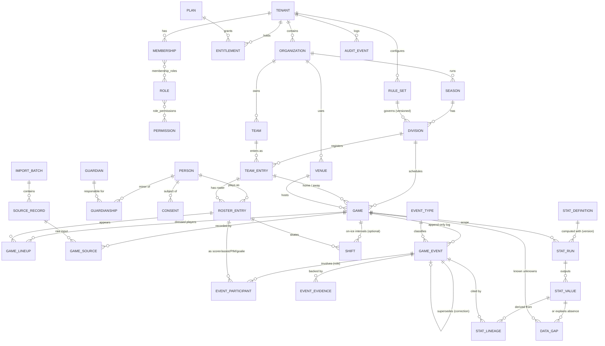

# VHI — database relationship diagram and multi-tenant security

**Status:** PROPOSED design. No SQL has been written, applied or run. Schema name in the new project: `vhi`.

## 1. Relationship diagram

Every table carries `tenant_id` (omitted in the diagram on child tables for readability; it is **mandatory** and composite-FK-enforced — see §2.3).

### 1.1 Table responsibilities (one line each)

| Table | Purpose / key constraints |
| --- | --- |
| `tenant` | A licensee (league, club, team). `data_class` (`synthetic`/`production`), `status`, `locale`, `region` (US/CA). **No tenant name is referenced in code.** |
| `membership`, `role`, `permission`, `role_permissions`, `membership_roles` | Same *pattern* as HL-BOS: policies test **permissions**, never role names |
| `plan`, `entitlement` | What a tenant may use. `billing_mode` = `disabled` until approved |
| `rule_set` | Versioned JSON-schema-validated rules: periods, period length, OT/shootout, penalty catalog (minor/major/misconduct + minutes), points system, mercy rule. `effective_from`; games pin the version they were played under |
| `organization`, `season`, `division`, `team`, `team_entry`, `venue` | League structure. `team` is persistent; `team_entry` is that team in one division-season |
| `person` | Athlete/official/coach identity. **Minimum PII**: names, DOB *year-month* (age band), no address. DOB stored only if a rule needs it |
| `guardian`, `guardianship`, `consent` | Minors: who may see/share what. Consent rows are scoped (`stats_visibility`, `video`, `public_profile`) and revocable; revocation is a new row |
| `roster_entry` | A person on a team-entry with `jersey_number`, `position`, dates. **Stats attach here**, so a trade/new season never merges identities |
| `game` | Scheduled/played contest. `status` (`scheduled/live/final/forfeit/cancelled`), pinned `rule_set_id`+version, **no score columns** — score is *derived* |
| `game_lineup` | Who dressed; goalie flags. Needed for GP and for knowing who *could* have an event |
| `game_event` | **Append-only.** `event_type`, `period`, `clock_ms`, `team_entry_id`, `source_kind`, `recorded_by`, `recorded_at`, `supersedes_id`, `voided`. Goals, assists, shots, penalties, faceoffs, saves, goalie in/out, period start/end |
| `event_type` | Registry (data, not enum) with participant-role schema per type |
| `event_participant` | `(event, roster_entry, role)`; roles: `scorer, assist_1, assist_2, shooter, goalie, penalized, served_by, faceoff_winner, faceoff_loser` |
| `event_evidence` | Pointer to what supports an event: sheet image, video timestamp, import row. Required for any non-`scorekeeper` source |
| `shift` | Optional on-ice intervals. **Absent shifts ⇒ TOI and ±  are "not recorded"** |
| `source_record`, `import_batch`, `game_source` | Raw ingested input, kept verbatim for replay and dispute |
| `stat_definition` | Versioned formula (name, version, required event types, required optional-data such as `shift`). Immutable once published |
| `stat_run`, `stat_value`, `stat_lineage` | A computation, its outputs, and the exact `game_event` IDs behind each value. `stat_value.value` is nullable with `unavailable_reason` |
| `data_gap` | Explicit known-unknowns per game/stat ("shots not recorded for period 2"). Drives the "Not recorded" UI and a completeness score |
| `audit_event` | Append-only security/administrative log |

## 2. Multi-tenant security architecture

### 2.1 Isolation model
**Shared database, shared schema, row-level isolation by `tenant_id`, enforced by Postgres RLS — not by application code.** Rationale: hundreds of small teams/leagues cannot each have a database; RLS is the standard, testable control. A **dedicated project per enterprise licensee** remains possible later because the schema and migrations are self-contained (no cross-project FKs).

### 2.2 Rules (each is a test in Phase 1)
1. RLS **enabled and forced** on every table; default state is deny.
2. The tenant of the caller is resolved from `membership` via `auth.uid()` — **never from a client-supplied value or a JWT claim the user can influence.**
3. Policies call `vhi.has_permission(tenant_id, 'game_event.create')`; permission vocabulary `<domain>.<resource>.<action>` (closed action list), no implied hierarchy.
4. `game_event`, `audit_event`, `stat_lineage` have **no UPDATE/DELETE grant for any role, including tenants' admins**. Corrections are inserts with `supersedes_id`. A trigger rejects UPDATE/DELETE even for the table owner outside migrations.
5. Derived tables (`stat_run/value/lineage`) are written only by the service-role stat worker. **A tenant user cannot type a statistic** (same principle as `highlight.*` in HL-BOS 0049).
6. `vhi` schema is **not** in the API's exposed schemas. Browser access goes through a small set of RPC/edge functions that check permission, plus RLS as the second wall. No `SECURITY DEFINER` function is executable by `anon`; every one sets `search_path = ''` (the two things that produced 102 warnings in Venuewise Platform).
7. **Composite foreign keys** `(tenant_id, id)` on every child→parent reference make cross-tenant linkage structurally impossible, even from the service role by mistake.
8. Private storage buckets, path prefix `tenant_id/…`, enforced by CHECK on the metadata row and by storage policy.
9. `tenant.data_class` guard: trigger forbids inserting `source_kind='synthetic'` into a `production` tenant and forbids non-synthetic sources in a `synthetic` tenant.
10. Suspended/deactivated tenants lose access for **every** role (checked inside `has_permission`).

### 2.3 Role matrix (initial; permissions, not role names, are what policies check)

| Role | Scope | Can |
| --- | --- | --- |
| `platform_owner` / `platform_support` | platform | Provision tenants; support access is **time-boxed, tenant-approved, audited**; cannot read minors' data by default |
| `org_admin` | tenant | Configure rule sets, divisions, rosters, memberships |
| `league_operator` | tenant | Schedule, standings, officials, approve corrections |
| `scorekeeper` | tenant/game | Create events for assigned games only |
| `coach` | tenant/team | Read own team's full stats; no other team's raw events |
| `athlete` / `guardian` | person | Read own (or dependent's) stats, subject to `consent` |
| `public` | none | Only published, consent-cleared aggregates via a published view; never raw events |

### 2.4 Minors and cross-border privacy (design requirements, not legal advice)
- Minimum-PII schema; no precise location; no photos in core.
- Consent-gated visibility; revocation honoured on next read.
- Data region chosen per tenant (US vs Canada) — **Quebec Law 25 and PIPEDA** apply to Canadian tenants; **COPPA/state laws** to US minors. Counsel review is a Phase 0 dependency before any real data.
- Export and deletion (tenant exit; guardian request) are built features with tests, not promises.

### 2.5 Secrets and billing
Provider keys only in Supabase Vault / environment secrets, never in tables. Stripe (if used) in **test mode only** until explicit approval; `billing_mode = 'disabled'` is the default and is checked by the one function that could create a charge.

### 2.6 Threats the tests must defeat
Cross-tenant read/write via ID guessing; role escalation through self-editable membership; a coach rewriting a goal; a scorekeeper editing a finalized game; a suspended tenant continuing to read; synthetic data leaking into a production tenant; anon calling an RPC; service-role code writing a child row under the wrong tenant.
